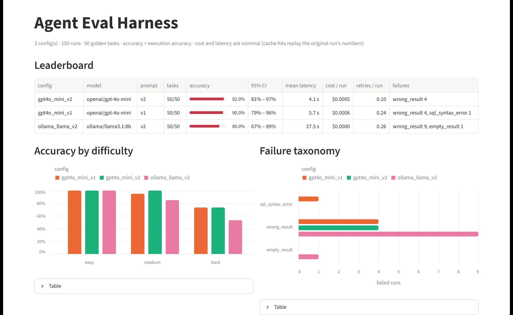
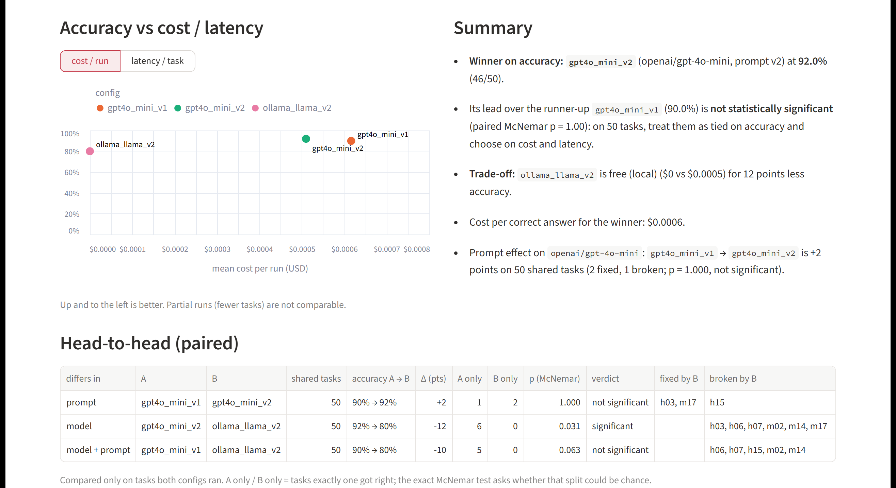
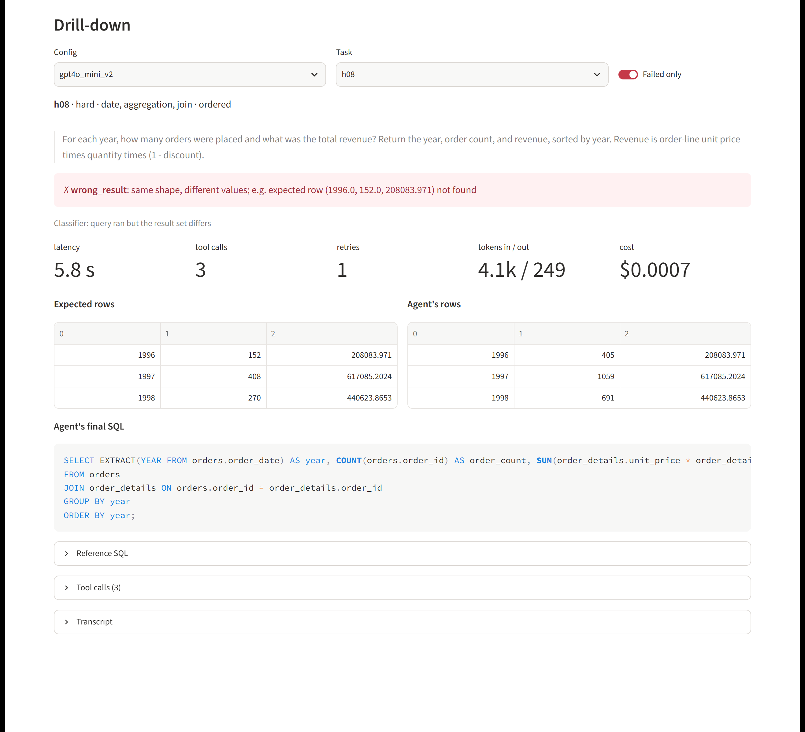

# Agent Eval Harness

[](https://github.com/atharva-bhusari/agent-eval-harness/actions/workflows/ci.yml)

A reusable **evaluation harness for LLM agents**. It runs an agent against a fixed, verified
golden task set and records a full trace of every run (tool calls, tokens, latency, cost). It
scores each answer on **execution accuracy** (does it return the right rows, however the SQL is
written) and classifies every failure into a **root-cause taxonomy**. It then compares
**models × prompt versions** with paired significance tests, in a Markdown report and a Streamlit
dashboard.

The reference agent is a **LangGraph text-to-SQL agent** over a local DuckDB copy of the
Northwind database (a food import/export company: customers, orders, products, suppliers,
employees). It sits behind a one-method `Agent` Protocol, so any agent can be evaluated
([how](#evaluate-your-own-agent)).

## Results

Execution accuracy on the 50-task golden set (95% Wilson interval). Source:
[results/REPORT.md](results/REPORT.md), generated from the metrics store.

| config | model | prompt | accuracy | mean latency | cost / run |
|---|---|---|---:|---:|---:|
| `gpt4o_mini_v2` | gpt-4o-mini | v2 | **92%** (81–97%) | 4.1 s | $0.0005 |
| `gpt4o_mini_v1` | gpt-4o-mini | v1 | 90% (79–96%) | 5.7 s | $0.0006 |
| `ollama_llama_v2` | llama3.1:8b (local) | v2 | 80% (67–89%) | 27.5 s | $0 |
| `haiku_v1` / `haiku_v2` | Claude Haiku 5.5 | v1 / v2 | pending (needs an API key) | | |

- **A prompt's value depends on the model.** v2 puts the schema in the prompt.
  - **On gpt-4o-mini** it adds only +2 points: 2 tasks fixed, 1 broken, and a paired McNemar
    p = 1.0 means no real difference. But each task is 28% faster and 17% cheaper, because the
    model skips schema discovery (2.3 tool calls per task instead of 5.2).
  - **On llama3.1:8b** it's the difference between working and not: without it, the model
    invents column names.
- **Model choice is a real difference.** gpt-4o-mini v2 beats local llama v2 by 12 points
  (6 tasks to 0, p = 0.03), at about $0.0005 per question vs $0 and 7× lower latency.
- **Hard tasks are the ceiling.** gpt-4o-mini scores 100% on easy tasks and 73% on hard ones.
  The misses are real analyst mistakes, and different models make the same ones:
  - counting order lines instead of orders after a join (below);
  - swapping `DATEDIFF`'s arguments;
  - returning the top product overall instead of the top product per category.
- Both gpt-4o-mini configs (100 runs) cost about **$0.06** in total. Re-runs are served from
  the response cache at $0.

### Dashboard





Drill into any run: the question, expected vs agent rows, final SQL, the classifier's reason,
tool calls and the full transcript. Here gpt-4o-mini gets revenue exactly right, but
`COUNT(order_id)` after joining order lines counts *lines* (405), not *orders* (152):



## How it works

```
 configs/*.yaml ──┐            (model × prompt, limits)
                  ▼
 tasks.yaml ──► RUNNER  async · timeout · retry/backoff · LLM response cache
 (50 verified)    │  ▲
                  ▼  │ tools: list_tables · get_schema · dry_run · run_sql (read-only)
          AGENT UNDER TEST  (LangGraph text-to-SQL, self-correcting) ──► DuckDB (Northwind)
                  │
                  ▼  AgentResult (rows, SQL, tool calls, tokens, cost, latency, transcript)
          SCORER: execution accuracy ──► CLASSIFIER: root-cause failure category
                  │
                  ▼
          METRICS STORE (SQLite, idempotent upserts)
                  ├──► results/REPORT.md  (leaderboard, CIs, paired McNemar, summary)
                  └──► Streamlit dashboard (charts, task grid, drill-down)
```

- **Golden set** ([data/tasks.yaml](data/tasks.yaml)): 50 questions (15 easy / 20 medium /
  15 hard). Each has reference SQL and a snapshotted expected result. `make verify-tasks` checks
  in CI that every reference query still reproduces its rows.
- **Execution accuracy:** rows are compared as a multiset, so row order doesn't count unless
  the question asks for it. Floats are rounded to 4 dp, NULL/NaN and dates are normalized, and
  one consistent column permutation is allowed. Correct SQL written differently still scores.
- **Failure taxonomy:** timeout, agent_error, wrong_tool (attempted write), empty_result,
  wrong_result, schema_hallucination, sql_syntax_error, max_iterations, other. The rules are
  ordered and give the *root cause*: a loop that hit the step limit while querying a made-up
  column counts as `schema_hallucination`.
- **Statistics:** Wilson intervals per config, and an exact McNemar test for every pair on the
  tasks both configs ran. The report says "not significant" in words.
- **Reproducibility:** temperature 0, a disk response cache keyed on the full request,
  deterministic DuckDB output, and run ids derived from (task, config, prompt), so re-runs
  overwrite instead of duplicating.

## Quickstart

Requires [uv](https://docs.astral.sh/uv/) (it installs Python for you). On Windows without
`make`, every target also runs as `uv run python tasks.py <target>`.

```bash
uv sync                 # install
make db                 # download the pinned Northwind dump (SHA-256 verified), build DuckDB
make test               # full test suite, no API key needed
make smoke              # 5-task end-to-end eval on a scripted LLM, no key, no cost
```

Run real evals. Hosted models need keys in `.env` (copy `.env.example`); local models need
[Ollama](https://ollama.com) (`ollama pull llama3.1:8b`).

```bash
make eval CONFIG=configs/gpt4o_mini_v2.yaml       # one config, 50 tasks
make sweep ARGS="--max-usd 1"                     # the model × prompt grid + REPORT.md
make sweep GRID=configs/sweeps/local.yaml         # free, offline prompt A/B (slow)
make dashboard                                    # http://localhost:8501
```

Or ask the agent a single question:

```bash
uv run python -m eval_harness.agent.text_to_sql "Which 5 customers placed the most orders?" --prompt v2
```

| Target | What it does |
|---|---|
| `setup` | install dependencies |
| `db` | download the pinned Northwind dump and build `data/northwind.duckdb` |
| `verify-tasks` | check every golden task's reference SQL reproduces its expected rows (50/50) |
| `eval CONFIG=…` | run all tasks for one config (`--tasks`, `--limit`, `--resume`) |
| `sweep` | run a grid (`configs/sweeps/`), skip configs without an API key, cap spend with `--max-usd`, regenerate `results/REPORT.md` |
| `report` | write `results/REPORT.md` from the store (`--configs a,b`) |
| `dashboard` | Streamlit app. Filters and the drill-down sync to the URL, so views are shareable links. |
| `reclassify` | re-label stored failures after a classifier change (no model calls) |
| `smoke` | 5-task end-to-end eval on a scripted LLM (what CI runs) |
| `test` / `lint` / `format` | pytest / ruff check + format check / ruff fix |

## Evaluate your own agent

An agent is anything with `run(question) -> AgentResult`, using structural typing with no base
class. The agent never touches the store. It returns rows, its final SQL and its trace, and the
harness does the scoring, classification and storage:

```python
import asyncio
from eval_harness import golden
from eval_harness.runner import run_eval
from eval_harness.store import Store
from eval_harness.types import AgentResult, Config

class MyAgent:
    def run(self, question: str) -> AgentResult:
        rows, sql = my_pipeline(question)          # your agent here
        return AgentResult(answer_rows=rows, final_sql=sql, tool_calls=[], n_retries=0,
                           prompt_tokens=0, completion_tokens=0, cost_usd=0.0, latency_ms=0)

config = Config(id="my_agent", model="custom/my-agent", prompt_version="v1")
with Store() as store:
    summary = asyncio.run(run_eval(config, golden.load_tasks(), store, agent=MyAgent()))
print(summary.render())   # then: make report / make dashboard
```

## Testing and CI

CI ([.github/workflows/ci.yml](.github/workflows/ci.yml)) runs on every push and **never needs
a paid API key**:
- ruff lint and format checks;
- build the database from the pinned dump;
- verify the 50 golden tasks;
- the full test suite: agent loop, scorer, classifier against real DuckDB error messages,
  store, runner, report statistics, and the dashboard rendered headless with Streamlit's
  `AppTest`;
- the **smoke eval**: 5 tasks through the real agent, runner, scorer, classifier, store and
  report, with a scripted model whose behaviour covers a correct answer, a self-correction
  after a DB error, a wrong answer and a hallucinated column. It fails the build if any
  outcome changes, and its report is uploaded as a build artifact.

## Layout

```
configs/              model × prompt configs; configs/sweeps/ = A/B grids
data/tasks.yaml       golden task set (questions, reference SQL, expected rows)
src/eval_harness/
  agent/              LangGraph text-to-SQL agent, tools + read-only guard, prompts
  db.py               Northwind build, schema helpers, result canonicalization
  llm.py              litellm client: cache, backoff, cost accounting
  runner.py           async eval runner          sweep.py   A/B grids
  scorers.py          execution accuracy         classify.py  failure taxonomy
  store.py            SQLite metrics store       report.py    REPORT.md + statistics
  dashboard.py        Streamlit app              smoke.py     CI smoke eval
results/REPORT.md     latest comparison report
docs/                 interview handbook, dashboard screenshots
tests/                unit, integration, dashboard and smoke tests
```

Design decisions and trade-offs are written up in
[agent-eval-harness-design.md](agent-eval-harness-design.md) (the build spec and status log) and
[docs/INTERVIEW_HANDBOOK.md](docs/INTERVIEW_HANDBOOK.md).

## License

[MIT](LICENSE)
